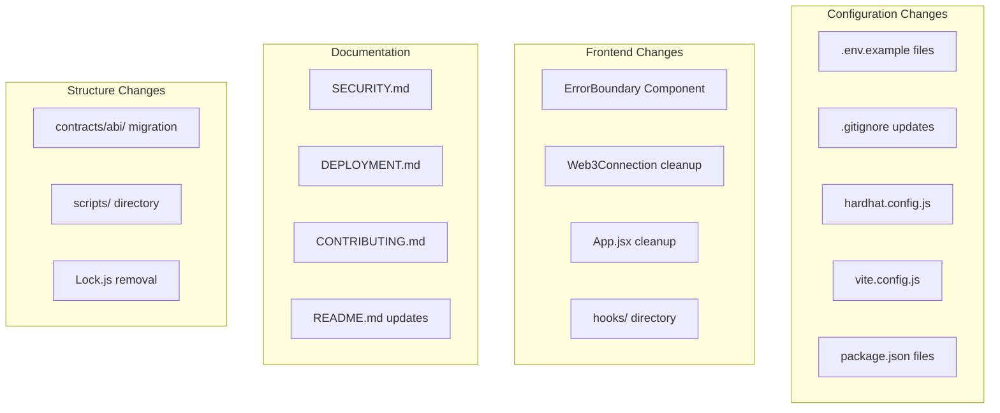

# Design Document: GreenSteps Security Hardening

## Overview

This design document outlines the technical approach for security hardening and project reorganization of the GreenSteps blockchain fitness application. The changes focus on improving security practices, reorganizing project structure, enhancing documentation, and improving code quality while preserving all existing functionality.

The implementation follows a non-destructive approach where existing functionality remains intact, and changes are additive or configurational in nature.

## Architecture

The existing architecture remains unchanged. This project modifies:

1. **Configuration Layer**: Environment variable management and build configuration
2. **Frontend Layer**: Error handling improvements and console log cleanup
3. **Documentation Layer**: New documentation files and README updates
4. **Project Structure**: File reorganization and cleanup



## Components and Interfaces

### 1. Environment Configuration Files

#### Root `.env.example`

```bash
# Deployment Configuration
PRIVATE_KEY=your_private_key_here
AXIOM_RPC_URL=https://rpc.axiom.network/
ETHERSCAN_API_KEY=optional_for_verification
```

#### Frontend `.env.example`

```bash
# Contract Configuration
VITE_CONTRACT_ADDRESS=0x_your_contract_address
VITE_AXIOM_RPC_URL=https://rpc.axiom.network/
VITE_CHAIN_ID=23413
```

### 2. ErrorBoundary Component

```jsx
// frontend/src/components/ErrorBoundary.jsx
interface ErrorBoundaryProps {
  children: React.ReactNode;
  fallback?: React.ReactNode;
}

interface ErrorBoundaryState {
  hasError: boolean;
  error: Error | null;
}
```

The ErrorBoundary component:

- Catches JavaScript errors in child component tree
- Displays fallback UI when errors occur
- Logs errors for debugging
- Provides reset functionality

### 3. Deployment Script

```javascript
// scripts/deploy-greensteps.js
async function main() {
  // Deploy GreenStepsToken
  // Verify contract if API key available
  // Output deployment information
}
```

### 4. Hardhat Network Configuration

```javascript
// hardhat.config.js additions
networks: {
  axiom: {
    url: process.env.AXIOM_RPC_URL,
    accounts: [process.env.PRIVATE_KEY],
    chainId: 23413
  }
}
```

### 5. Vite Build Configuration

```javascript
// vite.config.js additions
build: {
  rollupOptions: {
    output: {
      manualChunks: {
        vendor: ['react', 'react-dom'],
        mui: ['@mui/material', '@mui/icons-material'],
        ethers: ['ethers']
      }
    }
  },
  sourcemap: false
}
```

## Data Models

No new data models are introduced. This project focuses on configuration and structural changes.

### File Structure Changes

**Before:**

```
/
├── Contract information/
│   └── abi.json
├── ignition/
│   └── modules/
│       └── Lock.js
├── frontend/
│   └── src/
│       ├── components/
│       └── utils/
```

**After:**

```
/
├── contracts/
│   ├── abi/
│   │   └── GreenStepsToken.json
│   └── GreenStepsToken.sol
├── scripts/
│   └── deploy-greensteps.js
├── frontend/
│   └── src/
│       ├── components/
│       │   └── ErrorBoundary.jsx
│       ├── hooks/
│       └── utils/
├── .env.example
├── SECURITY.md
├── DEPLOYMENT.md
└── CONTRIBUTING.md
```

## Correctness Properties

_A property is a characteristic or behavior that should hold true across all valid executions of a system—essentially, a formal statement about what the system should do. Properties serve as the bridge between human-readable specifications and machine-verifiable correctness guarantees._

Based on the prework analysis, the following properties can be verified through automated testing:

### Property 1: Debug Console Log Removal

_For any_ JavaScript/JSX file in the frontend source directory, the file SHALL NOT contain `console.log` statements (excluding `console.error` for error handling).

**Validates: Requirements 2.1, 2.2, 2.3, 2.4**

### Property 2: ErrorBoundary Fallback Display

_For any_ React component wrapped in ErrorBoundary that throws an error during rendering, the ErrorBoundary SHALL render a fallback UI instead of crashing the application.

**Validates: Requirements 3.2**

### Property 3: ErrorBoundary Error Logging

_For any_ error caught by the ErrorBoundary component, the error details SHALL be logged using console.error for debugging purposes.

**Validates: Requirements 3.3**

### Property 4: README Hardcoded URL Removal

_For any_ URL pattern in README.md that references deployment-specific endpoints (excluding documentation links and static assets), the URL SHALL be replaced with environment variable references or placeholder text.

**Validates: Requirements 5.4**

### Property 5: Configurable Values Use Environment Variables

_For any_ configuration value in hardhat.config.js that is deployment-specific (RPC URLs, private keys, API keys), the value SHALL be loaded from environment variables using `process.env`.

**Validates: Requirements 10.2**

## Error Handling

### Environment Variable Validation

The hardhat configuration should validate required environment variables at startup:

```javascript
// Validate required environment variables
const requiredEnvVars = ["PRIVATE_KEY", "AXIOM_RPC_URL"];
for (const envVar of requiredEnvVars) {
  if (!process.env[envVar]) {
    console.warn(
      `Warning: ${envVar} is not set. Axiom network deployment will not be available.`,
    );
  }
}
```

### ErrorBoundary Error Handling

The ErrorBoundary component handles errors gracefully:

1. Catches errors in `componentDidCatch` lifecycle method
2. Updates state via `getDerivedStateFromError`
3. Displays fallback UI with error message
4. Provides "Try Again" functionality to reset error state

### Deployment Script Error Handling

The deployment script includes:

1. Try-catch blocks around deployment operations
2. Informative error messages for common failures
3. Graceful handling of missing optional environment variables (ETHERSCAN_API_KEY)

## Testing Strategy

### Dual Testing Approach

This project uses both unit tests and property-based verification:

1. **Unit Tests**: Verify specific examples and edge cases
2. **Property Tests**: Verify universal properties across all inputs

### Unit Testing

Unit tests focus on:

- ErrorBoundary component behavior
- File existence verification
- Configuration file content validation
- Import path resolution

### Property-Based Testing

Property tests verify:

- Console.log removal across all frontend files
- Environment variable usage in configuration files
- URL pattern compliance in documentation

### Test Configuration

- Testing framework: Jest for React components, Mocha/Chai for Hardhat
- Minimum 100 iterations for property-based tests
- Each property test references its design document property
- Tag format: **Feature: greensteps-security-hardening, Property {number}: {property_text}**

### Existing Test Preservation

All existing tests in `test/GreenStepsToken.test.js` must continue to pass after changes. The test suite validates:

- Contract deployment
- Steps submission
- Rewards claiming
- Stats tracking
- Conversion rate updates

### Manual Verification Checklist

Some requirements require manual verification:

1. Visual inspection of ErrorBoundary fallback UI
2. End-to-end deployment to Axiom testnet
3. Frontend build and runtime verification
4. Documentation review for completeness
